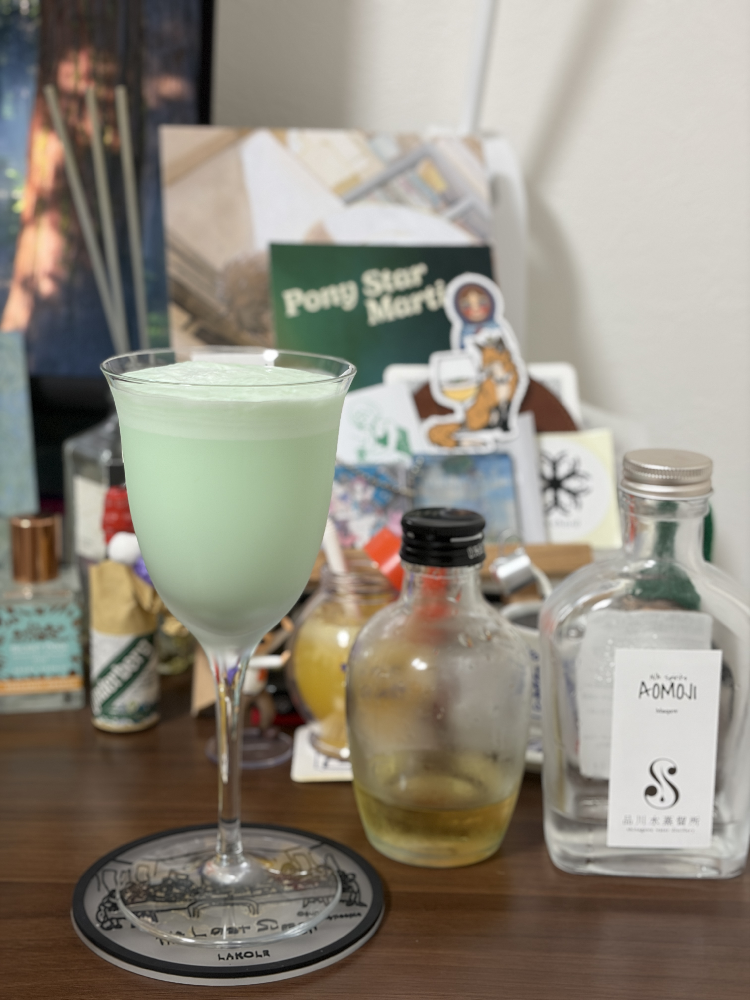
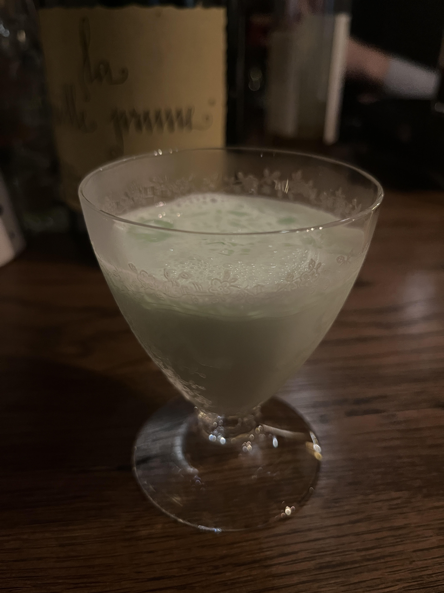
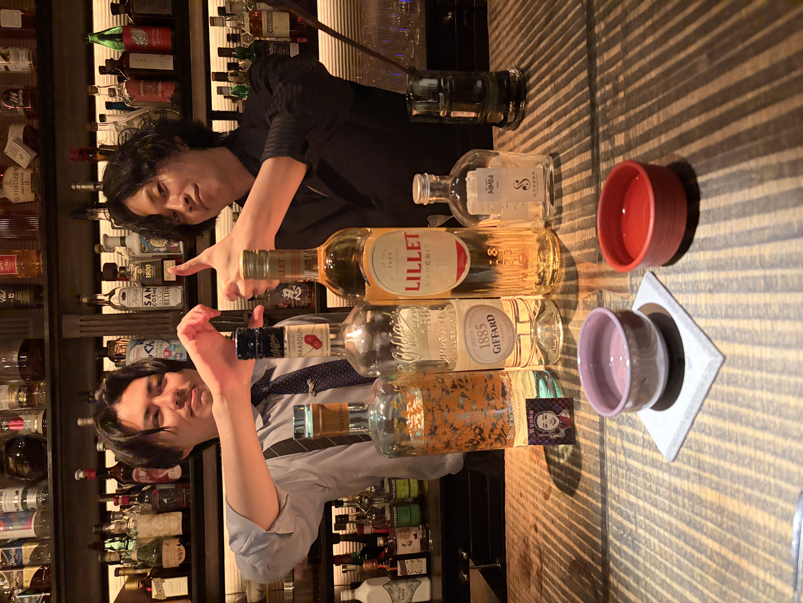
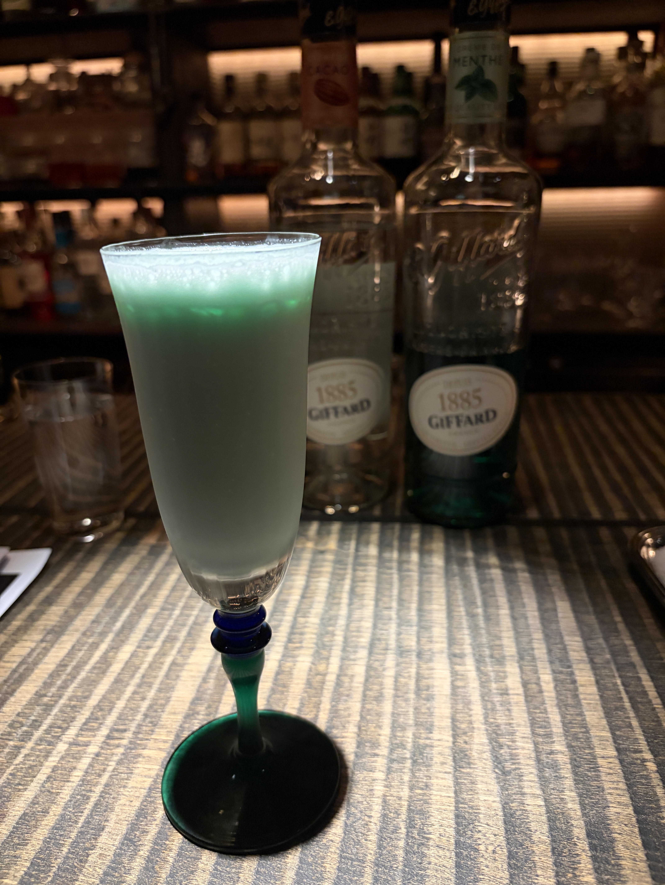
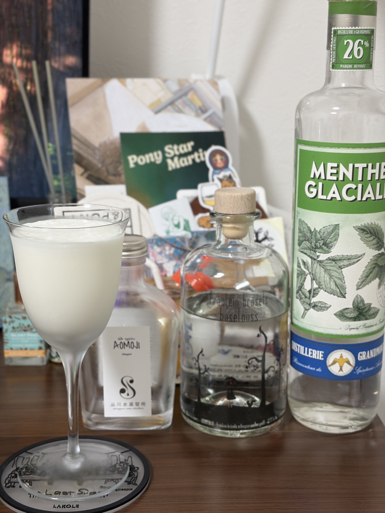

## アオモジグラスホッパーのソーダ割り

### レシピ

色々と語る前に，まず，私なりのレシピについて述べておこうと思います． 

<li>
グリーンミントリキュール：30ml
</li>
<li>
ホワイトカカオリキュール：10ml弱
</li>
<li>
生クリーム：30ml
</li>
<li>
トンカビーンズキンモクセイシロップ：1.5bsp強
</li>
<li>
アオモジ蒸留水：7.5ml強
</li>
<li>
レモン強炭酸水：35ml強
</li>

このレシピはBar Amberの伊藤大輔さんから教えていただいたものを参考にさせていただき，
6,7回しかつくっていないので，もっともっとよくできると思いますが，私の中で納得して，
確実に美味しく，他人に出せるレベルだと思います． 
各素材の後ろに強弱が書いてあるのは調整する時はそういう気持ちで調整していたというものです．

### カクテル概要

このカクテルの概要を私なりの言葉で少しだけ述べておこうと思います． 
まず，このカクテルはアオモジ蒸留水を主役に楽しむカクテルにしています． 
私の感覚では，アオモジ蒸留水は柑橘系やソーピーな感じとの相性がとても良いと感じました．(もちろん適当ではなく，色々なところで飲み歩いて感じた感覚です．) 
実際，このカクテルの起源の伊藤さんのグラスホッパーのアオモジソーダ割りもゲストシフトイベントで少し変わったラモスジンフィズをアオモジソーダ割りにしてみたことが着想の源のようです．

また，信憑性が十分かは別として，少しだけアオモジ蒸留水の香気成分について調べてみると，以下のものが多く含まれているようです．クスノキ科の植物からこのように豊かな香りがするのはとても面白いと思います．

<li><a href="https://ja.wikipedia.org/wiki/%E3%82%B7%E3%83%88%E3%83%A9%E3%83%BC%E3%83%AB">ゲラニアール(α-シトラール)</a></li>

鮮烈な柑橘香やピール感が特徴でレモンやライム，レモングラスを思わせる香り

<li><a href="https://ja.wikipedia.org/wiki/%E3%82%B7%E3%83%88%E3%83%A9%E3%83%BC%E3%83%AB">ネラール(β-シトラール)</a></li>

甘く，丸みのある柑橘香が特徴でまろやかなレモンやライムを思わせる香り

上記のようにアオモジ蒸留水には，柑橘の香りはもちろんあります． 
しかし，所謂レモンやオレンジのような柑橘にとても多く含まれている<a href="https://ja.wikipedia.org/wiki/%E3%83%AA%E3%83%A2%E3%83%8D%E3%83%B3">リモネン</a>がアオモジの蒸留水にはあまり含まれておらず，それをうまく組み合わせることで最高の相性にするというのが柑橘と相性が良いという部分なのかもしれません．

また，上記のものほど多くは含まれていませんが，以下も含まれています．

<li><a href="https://ja.wikipedia.org/wiki/%E3%83%AA%E3%83%8A%E3%83%AD%E3%83%BC%E3%83%AB">リナロール</a></li>

丸みあるフローラルさが特徴でラベンダーやすずらんやベルガモットを思わせる香り 

上記の香料は石鹸に使われることなどもあり，そういう意味もあり，相性が良いのかもしれません．

VIRTÙの小川杏香さんもフランセンスとかも相性良いかも！とおっしゃっており，納得です．(これについては後日ゆっくり考えることにしましょう．．．)

### 各素材について

各素材についても少しだけ述べておこうと思います． 
まず，グリーンミントリキュールですが，この選択は言語化が難しいのですが，感覚としてはレモンの強炭酸水に合うものを選ぶというのが私が一番大事にしている感覚です． 
アオモジ蒸留水の爽やかなレモングラス感などを台無しにしないかつレモンの強炭酸水で柑橘味を足すのでその際にフィットするものをフィットする量(普通のグラスホッパーに比べると少し多め)入れます． 
しかし，グラスホッパーの骨格の一つなので量はしっかり入れます．

次にカカオリキュールですが，これも言語化が難しいですが，一番上品で気品高いものの双対を選ぶと良いと思っています． 

上品なものを選ぶと，このカクテルの場合，全体的に上品すぎるものになってしまう気がします．(もちろんそれも良いと思うのですが．．．) 
カカオのビターさや土台は求めつつ，でもどこか身近なところに呼び戻してくれる何かが良いと思います．(私の中のイメージとしてはミントが乗ったレモンタルトのタルトっぽい部分を選びたいけど，少しビターにバランスよくしたいような感覚です．) 
量はこれが難しく，普通のグラスホッパーより少なめですが，慎重に調整する必要があると思います．

次に生クリームですが，ここは好みが少し分かれるのかなと思っています．(もちろんカクテル自体趣向品なので，すべてに関して好みが分かれると思っていますが．．．) 
私は乳脂肪分40%のものを使いました． 
比較はできていませんが，どちらかというと乳脂肪分は高い方を選ぶと良いかもしれません． 
また，牛乳とのブレンドは試したのですが，入れるなら少しだけかなと思います．

次にトンカビーンズキンモクセイシロップですが，これがこのカクテルを色々試して試して試してたどり着いた私の中の答えの一つです． 
といっても，トンカビーンズをキンモクセイシロップにつけて冷蔵庫で24時間放置しただけです． 
何かそういう丸みあるけどレモングラス感に合わせるものを求めて，キンモクセイシロップやアーモンドシロップやエルダーフラワーリキュールやマラスキーノリキュールやローズリキュールやさくらんぼの種だけを取り出し，シロップにしてみたりと色々思考したのですが，おそらくこれが一番美味しいです．

次にメインのアオモジ蒸留水です． 
贅沢に(？)7.5ml入れますが，状態により上下させると良いと思います． 
本当に素晴らしいので家に無限にほしいです． 
あとアオモジソーダ缶は喉から手が出るほど欲しいので販売してほしいです．

最後にレモンの強炭酸水です． 
これも地味にこのカクテルの構成の私の自慢の部分です． 
もちろん，普通の強炭酸水も試して，ソーダ割り自体が蒸留水の良さを爆発的によくするのはわかったのですが，すでに述べた部分で柑橘との相性をここで合わせます． 
本当に生クリームのカクテルをソーダ割りにしようと思った伊藤さんは天才ですよね．(もちろん与えられた才を持つのもありますが，努力の中で得た発想で素晴らしいという意です．)

### 作り方について

作り方はアオモジ蒸留水とレモンの強炭酸水以外をシェイカーに入れ，よく混ぜてから，フローサーでよく攪拌し，アオモジ蒸留水と氷を入れてシェイクして，注ぎ，少し置いてからレモンの強炭酸水を入れます．

伊藤さんは氷を3つ入れてシェイクして，アオモジ蒸留水を追加して，もう一度シェイクしていましたが，この辺の差は私の技術がないので，加水とエアレーションと温度変化の調整がこの方法がしやすいだけでそんなに大差無いと思います．(技術には大差がもちろんありますが，やりたいことに大差はないと思います．)

シェイクはよく冷やす、空気をちゃんと入れる、でも加水しすぎないことと氷を割りすぎないことを意識して振っています．(この加水しすぎない調整が難しくて、私は2回シェイクするのを辞めました．)
フローサーの攪拌で素材を混ぜることと生クリームを泡立てることとエアレーション部分を助けます． 
もちろんシェイクのエアレーションとは違いますが，2種類のエアレーションも面白いかなと． 
これで口当たりも味わいも全然変わってきます．

話はそれますが，少し懐かしい昔話をすると昔にB&Fで伊藤さんにいただいたグラスホッパーはあえて氷を砕き，少しだけアブサンを入れると面白いというのも懐かしい話です． 
振り下ろすようなシェイクで素晴らしかったですね．

### このカクテルへの想い

このカクテルとの出会いはBar Amberで伊藤さんに勧められた時でした． 
元々蒸留水についてはBar Amberに行くとたくさんいろんなカクテルやそのままでいただいていたりしていて，その中で私がとても面白いかつ市販で買えるものがアオモジ蒸留水でした． 

少しだけ脱線し，アオモジ蒸留水について思考を深めた話を述べておこうと思います． 
伊藤さんと入さんとふとしたきっかけでアオモジ蒸留水とお茶を合わせた何かを考えたいねという話になり，考えた上で凍頂烏龍茶を選択し，これについて思考を深める最高のひとときがありました． 

ここで詳しく書くことはしませんが，2日間(日を跨いだことを加味すると4日間)の素晴らしいひとときでした． 

さて，話を本題に戻します． 
アオモジグラスホッパーを以前飲んだ上でグラスホッパーのアオモジソーダ割りを飲ませていただきました．(アオモジグラスホッパーについてはまた別の機会にしましょう．) 
この時は少し薔薇の蒸留水も入れてもらっていたかもしれません． 

生クリームのカクテルをソーダで割るという思考が私にはなく，最初に伊藤さんから聞いた時は信用できず，普通のアオモジグラスホッパーを飲みました笑 
しかし，気になり，日を変えて，アオモジソーダ割り飲んでみると，これが素晴らしい！ 
さらに，ここまでも述べてきましたが，よく考えてみると理にかなった組み合わせで本当に感覚が素晴らしいと思いました．(もちろん伊藤さんがよく考えられていることは言うまでもなく．)

私はここから原型を尊重し，しかし，私の最高のツイストカクテルをと思い，数ヶ月だけ考え，試行錯誤してみました． 
トンカビーンズを使ったのは別のカクテルでmementomoriの浦里さんがカクテルに削ってくれて，そのカクテルの香りとトンカビーンズ自体の香りを体験させていただき，そこから発想を得ています． 
少し思い返してみると伊藤さんっぽい組み方をしてなくもないなと思い，少し笑ってしまいました． 
私はこういう原型のあるカクテルは脳内にその人を降ろし，この人ならどういう思考をするか，その人との会話を細部まで全て思い出し，思い付いたものは安易にせず，熟考した上で形にせよ．という精神を持っているので，そうなっていくのかもしれません． 
トンカビーンズキンモクセイシロップがまさにその形にしたものの一つですね笑

### おまけ(アオモジスノウホッパーのソーダ割り)

最後におまけです． 
私の推しのバーテンダーさんはバッタが苦手でグラスホッパーをつくらないというのがあり，いつもスノウホッパーを作ってくれます． 
それを踏まえ，グリーンミントリキュールの代わりにホワイトミントリキュールを使ってツイストも考えてみました． 

<li>
ホワイトミントリキュール：25ml弱
</li>
<li>
ヘーゼルナッツシュナップス：7.5ml弱
</li>
<li>
生クリーム：30ml
</li>
<li>
アオモジ蒸留水：7.5ml強
</li>
<li>
レモン強炭酸水：40ml強
</li>

やはりレモングラスとの相性の良さからホワイトミントリキュールを選びたく，甘みの少ないものを選択したので，それに合わせるようにホワイトカカオリキュールはヘーゼルナッツシュナップスを使ってみることで全体的に甘みを少なめの構成でまとめることにしてみました． 
とても美味しいのですが，私の好みはアオモジグラスホッパーのソーダ割りでした．(これは本当に好みの問題でこちらもものすごく美味しいですが，僅差でアオモジグラスホッパーのソーダ割りだなという感覚です．)

### 謝辞

このカクテルを作成するにあたり，Bar Amberの伊藤大輔さんをはじめとするたくさんのバーテンダーさんにお世話になりました． 
また，このような素晴らしい蒸留水を作成されている<a href="https://shinagawadistillery.com/ja?srsltid=AY6E960yNMlZQVwm6Q9Hliry36CVvkSJIFIp9WZJI_qVqauwBxnGxVt7">品川水蒸溜所さん </a>にもイベントで直接お話を聞かせていただいたり，その場で蒸留した様々な蒸留水を味見して今回のメインのアオモジ蒸留水を購入させていただきました． 

全ての方々に感謝申し上げます．

---

**[一覧に戻る](/cocktail)**